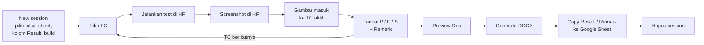
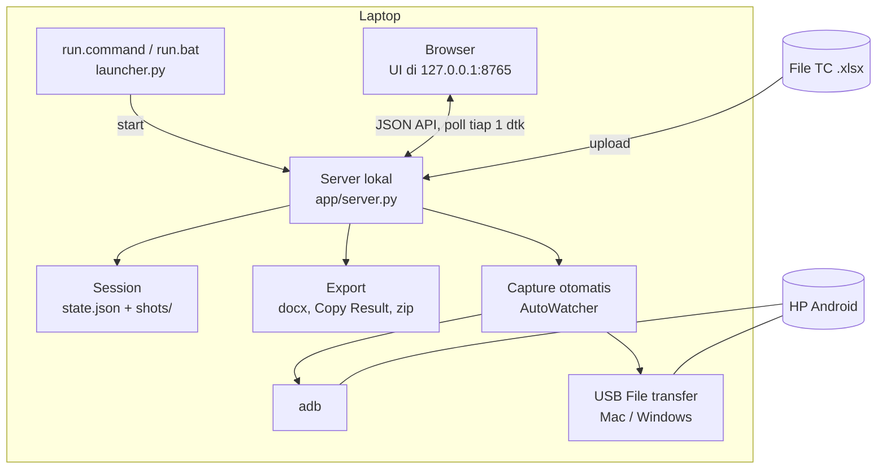
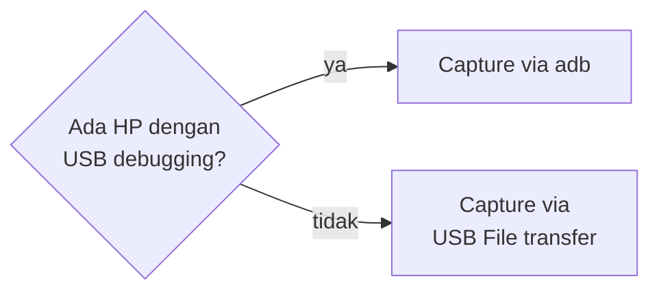

# Cara Kerja Regression Evidence

Tester cukup **memilih TC → menjalankan test → menekan tombol screenshot di HP → menandai Pass/Fail**.
Tool memasukkan screenshot ke TC yang aktif, menyusun dokumen bukti `.docx`, dan menyiapkan teks
Result/Remark untuk di-paste ke Google Sheet. Tidak perlu crop, rename, atau tempel gambar manual.

Cara install ada di [README](../README.md).

## Daftar isi

1. [Alur pemakaian](#1-alur-pemakaian)
2. [Arsitektur](#2-arsitektur)
3. [Capture screenshot otomatis](#3-capture-screenshot-otomatis)
4. [Data session](#4-data-session)
5. [Output](#5-output)
6. [Keamanan data](#6-keamanan-data)
7. [Batasan yang diketahui](#7-batasan-yang-diketahui)

---

## 1. Alur pemakaian

1. **New session:** pilih file `.xlsx` → sheet → kolom Result → versi build → **Mulai**.
   Pilih "(tanpa kolom result)" bila semua TC ingin mulai dari Todo.
2. **Pilih TC:** klik di daftar, atau `↑` / `↓`. TC aktif **tidak** pindah sendiri, karena jumlah
   screenshot per TC berbeda-beda.
3. **Screenshot di HP:** gambar muncul di TC aktif dalam beberapa detik, dengan toast `+1 → <modul> TC<nnn>`.
4. **Tandai status:** `P` Pass, `F` Fail, `S` Skip. Isi Remark bila perlu.
5. **Kelola gambar:** klik untuk memperbesar; hapus, pindah ke TC lain, atau geser urutan.
   `Del` menghapus gambar terakhir TC aktif.
6. **Preview Doc:** lihat susunan dokumen kapan saja. Isinya sama dengan hasil `.docx`.
7. **Generate DOCX:** file disimpan di `sessions/<session>/out/`. Sebelumnya tool memperingatkan
   TC yang belum punya gambar atau masih Todo.
8. **Copy Result / Copy Remark:** klik sel baris pertama di kolom yang sesuai di Google Sheet, lalu `Ctrl/Cmd+V`.
9. **Hapus session** di layar awal setelah dokumen di-upload. Penghapusan permanen, termasuk screenshot.

Berhenti di tengah: tutup saja, semua tersimpan otomatis. Buka lagi → **Lanjutkan**.

Hotkey (nonaktif saat mengetik):

| Tombol | Fungsi |
| --- | --- |
| `↑` / `↓` | TC sebelumnya / berikutnya (mengikuti filter) |
| `P` / `F` / `S` | Pass / Fail / Skip |
| `Del` | Hapus gambar terakhir TC aktif |
| `Esc` | Tutup preview gambar besar |

---

## 2. Arsitektur

Semua berjalan di laptop tester. Tidak ada server luar dan tidak ada akses jaringan selain `127.0.0.1`.

| Komponen | File | Tugas |
| --- | --- | --- |
| Launcher | `launcher.py`, `run.command`, `run.bat` | Buat `.venv`, install dependency, start server, buka browser. Bila server sudah jalan, hanya membuka browser. |
| Server | `app/server.py` | HTTP server lokal, JSON API, file UI. Satu proses, operasi dikunci (lock) sehingga beberapa tab aman. |
| UI | `app/static/` | HTML/JS/CSS tanpa build step. Polling `/api/state` tiap 1 dtk. |
| Pembaca TC | `app/tcsource.py` | Membaca `.xlsx` menjadi daftar TC. |
| Session | `app/session.py` | Status, remark, gambar per TC; simpan ke disk. |
| Sinkron Excel | `app/sync.py` | Menggabungkan versi Excel baru ke session. |
| Capture | `app/capture_*.py` | Mengambil screenshot baru dari HP. |
| Export | `app/docx_export.py`, `app/results_export.py`, `app/archive.py` | DOCX, teks Result/Remark, zip session. |

### Membaca file TC

- Header = baris pertama (dalam 10 baris awal) yang memuat `No TC`.
- Kolom wajib: `No TC`, `Function` (modul), `Scenario` (judul). Opsional: `Type`, `Expected Result`, `Step`,
  `Result Android …`, `Result IOS …`, `Remark`.
- `Function` kosong (merged cell) mewarisi baris di atasnya.
- `No TC` duplikat atau kolom wajib hilang → pesan error yang jelas.
- Status awal diambil dari kolom Result terpilih: `Pass`/`Fail` tetap, `No Run` → Skip, lainnya → Todo.
- Penomoran dokumen: `TC001`, `TC002`, … **per modul**, urut baris sheet.

---

## 3. Capture screenshot otomatis

### Memilih jalur

`AutoWatcher` (`app/capture_auto.py`) mengecek setiap 2 dtk:

- Hanya satu jalur aktif dalam satu waktu, jadi screenshot tidak tertangkap dua kali.
- HP diganti (dengan atau tanpa USB debugging)? Jalur ikut berganti otomatis.
- Satu laptop = satu HP.

### Jalur adb (`capture_adb.py`)

1. Saat session dibuka, daftar file di folder Screenshots dicatat sebagai file lama.
2. Folder dipantau tiap ±1 dtk lewat `adb`.
3. File baru → tunggu ukurannya stabil → ditarik dengan `adb exec-out cat` → masuk ke TC aktif.
4. Versi build dibaca dari `dumpsys package <package>` bila `package` diisi di `config.json`.

### Jalur USB File transfer, Mac (`capture_mtp_mac.py`)

- Memakai ImageCaptureCore (framework kamera/HP bawaan macOS).
- **Jalur cepat:** HP mengirim sinyal "file baru" (PTP event). Tool langsung meminta info lalu isi file,
  tanpa menunggu macOS selesai membaca seluruh daftar file HP.
- **Jalur cadangan:** katalog file dari macOS. Lengkap, tapi setelah dicolok bisa ±1–2 menit untuk ±20 ribu file.
- Koneksi ke HP ditutup saat server berhenti. Kalau tidak, macOS menyembunyikan HP sampai kabel dicabut-colok.

### Jalur USB File transfer, Windows (`capture_mtp_win.py`)

- HP muncul di "This PC". Tool memakai Explorer shell (`Shell.Application` lewat `pywin32`).
- Mencari folder `DCIM/Screenshots` dan `Pictures/Screenshots` di semua storage HP.
- Folder dibaca ±1 dtk sekali (listing ±2 dtk untuk ±1.400 file). File baru disalin ke folder sementara
  (±0,3 dtk), dibaca, lalu dihapus dari folder sementara.
- Pembacaan pertama setelah dicolok butuh ±20–70 dtk.
- Mendeteksi dan memberi pesan untuk: HP tidak ada, mode Charging (isi tidak terlihat), folder Screenshots
  belum ada, HP dicabut, dan isi yang tiba-tiba hilang (layar terkunci).

### Menentukan "screenshot baru" (USB File transfer)

Dipakai bersama oleh Mac dan Windows (`MtpTracker`). Sebuah file ditangkap bila:

| Syarat | Alasan |
| --- | --- |
| Berada di folder bernama *Screenshot…* | Foto kamera dan file lain tidak ikut |
| Nama tidak diawali titik | Android menulis `.pending-…` dulu lalu me-rename |
| Ekstensi `.png`, `.jpg`, `.jpeg`, `.webp` | Hanya gambar |
| Tanggal file ≥ saat HP terhubung | File lama di HP tidak ikut, walau daftar file baru muncul belakangan |
| Belum pernah diproses (per folder/nama) | Tidak tertangkap dua kali |

Khusus Windows, batas waktunya diberi toleransi 15 dtk. Alasannya, saat "File transfer" dipilih Windows
sempat melepas lalu mendeteksi HP lagi, dan jam HP bisa sedikit terlambat dari laptop.

### Saat gambar masuk

- Ada TC aktif → gambar disimpan sebagai `<modul>_<no-tc>_<k>.<ext>` di `shots/`, lalu toast `+1 → …`.
- Tidak ada TC aktif → gambar diabaikan, toast "Screenshot diabaikan: pilih TC dulu".
- File di HP **tidak** dihapus atau diubah.

---

## 4. Data session

Satu session = satu kombinasi sheet + platform + build, disimpan di
`sessions/<YYYY-MM-DD>_<platform>_<build>_<sheet>/`:

| Isi | Fungsi |
| --- | --- |
| `source.xlsx` | Salinan file Excel yang di-upload |
| `state.json` | Daftar TC, status, remark, urutan gambar, TC aktif |
| `state.json.bak` | Versi sebelumnya, untuk pemulihan bila `state.json` rusak |
| `shots/` | Screenshot asli |
| `trash/` | Gambar yang dihapus dari TC |
| `out/` | Hasil `.docx` |

- **Autosave:** setiap perubahan langsung ditulis secara atomik (file sementara → rename).
- **Lanjutkan:** layar awal menampilkan daftar session beserta progresnya.
- **Sync Excel:** pilih versi `.xlsx` baru (nama sheet sama). Pencocokan berdasarkan `No TC`:
  TC baru ditambahkan sebagai Todo; teks yang berubah diperbarui (status, remark, gambar tetap);
  TC yang hilang dipindah ke grup "Dihapus dari Excel" dan tidak masuk dokumen. Perubahan ditampilkan
  dulu sebelum diterapkan.
- **Export/Import:** session dikemas menjadi `.zip` (tanpa `trash/`) untuk dipindah ke laptop lain.
  Path di zip divalidasi saat import.

---

## 5. Output

### Dokumen bukti `.docx`

- Nama file: `Regression _ <sheet> - <Platform> <build>.docx` di `out/`. Generate ulang menimpa file lama.
- Struktur: **Heading 1** = modul → **Heading 2** = `TC<nnn> - <judul>` → semua gambar TC berjajar → page break.
- Lebar gambar: 1–2 gambar = 7,6 cm; 3 gambar atau lebih = 5,1 cm. Tinggi proporsional.
- Gambar di dokumen adalah salinan yang diperkecil (lebar maks 800 px, JPEG kualitas 85). File asli tidak diubah.
- TC Skip tanpa gambar dan TC yang dihapus dari Excel tidak dimasukkan.

### Copy Result / Copy Remark

- Teks satu baris per baris Excel, dari TC pertama sampai TC terakhir. Baris non-TC di antaranya
  menjadi baris kosong, supaya paste tetap sejajar.
- Result: `Pass`, `Fail`, `No Run` (Skip), `Todo`. Remark: baris baru diganti spasi.
- UI menyebut sel tujuan, misalnya "Klik sel … baris 2 di Sheet, lalu Ctrl/Cmd+V".
- Status dan remark **tidak** ditulis ke file `.xlsx`.

---

## 6. Keamanan data

Screenshot bisa berisi **data pribadi/sensitif** dari app yang diuji.

- Server hanya bind `127.0.0.1`, jadi tidak bisa diakses dari jaringan.
- Request dengan `Host` / `Origin` selain `127.0.0.1` / `localhost` ditolak (403). Ini mencegah situs lain
  di browser mengakses tool.
- Folder `sessions/` di-gitignore. **Jangan di-commit, jangan dikirim keluar.**
- **Hapus session** setelah dokumen di-upload.
- File Export `.zip` hanya dikirim lewat kanal yang aman.

---

## 7. Batasan yang diketahui

- **iOS** belum didukung untuk capture otomatis.
- Screenshot yang diambil saat tool tertutup **tidak** ditangkap.
- USB File transfer: ada jeda awal setelah kabel dicolok (Windows ±20–70 dtk, Mac ±40–70 dtk);
  screenshot pada jeda itu masuk setelahnya.
- Setiap kabel dicabut-colok, HP kembali ke mode Charging dan "File transfer" harus dipilih lagi.
- Versi build hanya terbaca otomatis lewat adb. Lewat File transfer, isi manual.
- Satu laptop = satu HP dalam satu waktu.
